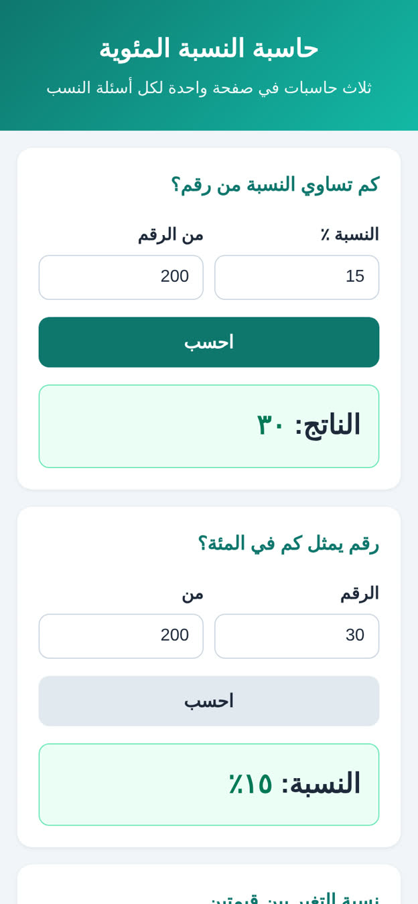

# Percentage Calculator | حاسبة النسبة المئوية

Every percentage question in one page: X% of Y, X as a percentage of Y, and percentage increase or decrease. Arabic interface.

**Live app:** https://abood-ayman.github.io/percentage-calculator-ar/

This is a personal project, built with AI tools.

## Features
- What is a percentage of a number (e.g. 15% of 200)
- A number as a percentage of another
- Percentage increase or decrease between two values (prices, salaries, grades)

## Privacy
Everything runs in your browser. No data is stored or sent anywhere.

## Run locally
Open `index.html` in any browser. It is a single static page with no dependencies.

## Status
Stable.

## Copyright
MIT License - Copyright (c) 2026 Abdullah Ayman.
